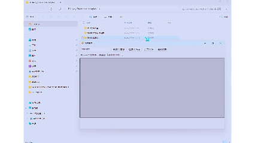

# 交件清单

拖入一个文件夹，检查发票、付款截图、报销单等材料是否备齐。

## 使用演示

从 [v1.0.0 发布页](https://github.com/qmzh-zyz/handdoff-checklist/releases/tag/v1.0.0) 下载 Windows 免安装包和测试样例，解压后双击 `DeliveryCheck.exe`。

1. 选择「报销材料」模板，把 `02-缺件与手动归类` 文件夹拖入窗口。
2. `发票.jpg` 自动归为发票，`IMG_1234.jpg` 显示「待确认」。此时缺少付款截图和报销单。
3. 选中 `IMG_1234.jpg`，可点击「打开文件」查看，然后在「手动归类」列选择「付款截图」。结果立即更新为只缺报销单。
4. 点击「复制结果」，即可将补件说明粘贴到聊天或邮件。



## 使用

在 Windows 10/11 上双击 `DeliveryCheck.exe`。选择模板，拖入一个文件夹，或点击「选择文件夹」。只扫描第一层，按文件名关键词和后缀归类，按模板中的最低数量计算缺件。最低数量填 0 表示可选，缺少时不会提示补件。匹配多项的文件标为「有歧义」，未命中的标为「待确认」。

对于 `IMG_1234.jpg` 这类文件，可选中后点「打开文件」，然后在「手动归类」列指定类别。每个文件只计入一项。重新扫描或更换模板会清除本次手动归类。点击「复制结果」可将补件说明放进剪贴板。

点击「编辑并另存」可新增模板。每行的关键词和后缀用逗号分隔。关键词匹配不区分大小写，任一关键词命中且后缀符合才会自动归类。模板保存在 `%LOCALAPPDATA%\DeliveryCheck`。应用离线运行，检查时不会写入所选文件夹或修改材料。检查依据是名称、后缀和数量，文件内容由用户核对。

## 从源码编译

在源码目录打开 PowerShell，运行以下命令。使用 Windows 自带的 .NET Framework 4.x 编译器，无第三方依赖。

```powershell
& "$env:WINDIR\Microsoft.NET\Framework64\v4.0.30319\csc.exe" /nologo /target:winexe /optimize+ /out:DeliveryCheck.exe DeliveryCheck.cs
```

## 自测

```powershell
$p = Start-Process -FilePath .\DeliveryCheck.exe -ArgumentList '--self-test' -Wait -PassThru
$p.ExitCode
```

退出码为 0 表示通过。覆盖后缀大小写、文件夹扫描范围、待确认和歧义、手动归类后更新缺件状态，以及模板序列化。

[MIT](LICENSE)
